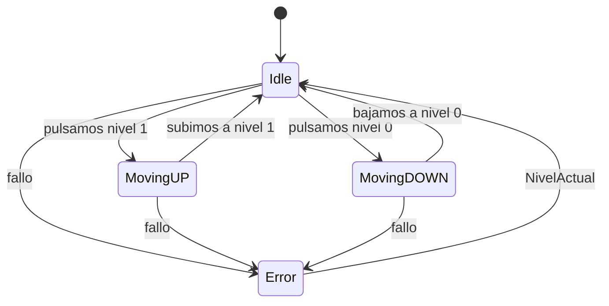

# SOLUCIÓN
Examen PMDM Diego Currás Rodríguez

## Estados

### Idle
Espera a que reciba un mandato de la botonera

### MovingUp
Mueve el ascensor del piso 0 al 1

### MovingDown
Mueve el ascensor del piso 1 al 0

### Error
Aparece en caso de excepción y <b>vuelve a Idle</b> donde se quedó antes del error
> [!IMPORTANT]
> Esto último de que Error vuelve a Idle es un parámetro no presenciado en el enunciado, es una adición a mayores que tomé para realizar las pruebas

## Transiciones
### Idle 
 Puede ir tanto a MovingUP si botonera es Nivel_1
 MovingDOWN si botonera es Nivel_1
 Error si no cae en ninguno de los anteriores (aunque es imposible actualmente ya que enum solo deja esos 2 valores, pero la excepción está puesta por si acaso)

### MovingUp
Dará error en caso de que el piso actual sea el mismo que se ha escogido
 En caso de que el nivel introducido sea correcto parasá e irá al nivel 1

### MovingDown
Dará error en caso de que el piso actual sea el mismo que se ha escogido 
 En caso de que el nivel introducido sea correcto parasá e irá al nivel 0

### Enum
Realicé un enum con 2 variables para que funcionara como la botonera del halo, caad botón devuelve un int que será el nivel al que se querrá ir

## Test
Se ha realizado un test sobre cada estado posible

## Esquema
